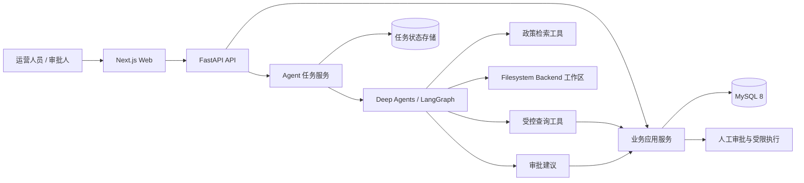

# AfterCare AI 架构设计

> 状态：目标架构初稿。当前仓库仅完成文档初始化，图中组件尚未实现。具体依赖版本、部署拓扑和部分边界标记为待确定。

## 1. 架构目标

- 为订单、售后工单和退款提供可信的业务数据与规则层。
- 允许 Agent 通过受控工具执行调查，而不是直接获得数据库万能权限。
- 把事实、推断、建议、审批和执行划分为不同责任边界。
- 支持任务持久化、恢复、审计和可复现评测。
- 以单体模块化应用起步，按实际负载和团队需求演进。

## 2. 目标上下文

`Redis`、独立任务队列、MCP 服务和向量数据库是否进入该拓扑，分别在任务并发、跨进程执行、外部工具集成和检索质量出现明确需求后决定。

## 3. 逻辑模块

### 3.1 Web 前端（待实现）

- 提交调查请求、查看计划进度、证据和建议；
- 展示订单/工单/退款数据；
- 提供审批操作界面；
- 只负责交互，不作为权限和业务规则的最终执行者。

### 3.2 API 与应用服务（待实现）

- 对请求进行身份识别、权限检查和 Pydantic 校验；
- 编排订单、工单、退款、政策和审批用例；
- 提供稳定的业务接口与错误契约；
- 在进入持久化或敏感执行前强制业务不变量。

### 3.3 领域与数据访问（待实现）

- 使用 SQLAlchemy 2 映射 MySQL 数据；
- Repository 隔离查询/持久化细节，Service 承载跨实体规则；
- Alembic 管理数据库迁移；
- 领域模型的精细程度以 Phase 1 业务分析为准，不提前采用复杂 DDD 框架。

### 3.4 Agent 任务服务（待实现）

- 创建调查任务并管理生命周期；
- 调用 Agent 工作流、流式输出进度、保存结果；
- 关联运行配置、检查点、工具调用与错误；
- 将 Agent 生成的敏感建议交给业务服务重新验证。

### 3.5 Agent 层（待实现）

首版为一个 `AfterCare Orchestrator`：理解问题、制定计划、调用工具、评估证据完整性并汇总结果。

后续候选 Subagents：

- `Data Analyst`：处理确定性的统计查询、趋势和关联分析；
- `Policy Specialist`：检索版本化政策、比对条件并返回条款引用。

只有当任务隔离、上下文质量或评测结果证明拆分有收益时才启用 Subagents，并保留相同案例的单 Agent 基线。

### 3.6 工具与 MCP（待实现）

- 业务工具通过应用服务读取数据，返回明确、受限、可审计的结构；
- 只读查询工具和敏感写入工具分离；
- MCP 用于需要跨进程或标准化集成的企业工具，不是所有内部函数的默认封装；
- 工具输出应包含数据来源标识、查询时间和必要的证据字段。

## 4. 关键数据流

### 4.1 售后调查

1. API 校验用户请求并创建调查任务。
2. Agent 分解问题，识别必要数据与政策。
3. Agent 通过受控工具调用应用服务；应用服务检查权限并查询 MySQL。
4. 工具返回结构化事实，Agent 记录来源并判断是否需要补充查询。
5. Agent 生成结构化结果：已确认事实、政策依据、推断、信息缺口、风险和建议。
6. 服务端保存结果、运行元数据和审计信息，前端展示。

### 4.2 敏感建议与审批

1. Agent 只能创建结构化建议，不能直接写退款结果。
2. 应用服务重新读取最新数据，验证状态、资格、金额和权限。
3. 通过验证后创建审批请求；未通过则返回确定性拒绝原因。
4. 审批人作出决定，系统记录操作者、时间和理由。
5. 执行前再次校验，使用幂等键避免重复操作。首版是否实现自动执行待确定。

## 5. 状态与存储边界

| 数据类型 | 内容 | 目标存储 | 原则 |
| --- | --- | --- | --- |
| 核心业务数据 | 订单、工单、退款、政策、审批 | MySQL | 强约束、事务、审计 |
| Agent 运行状态 | 任务、步骤、检查点、运行配置 | LangGraph checkpointer/持久化适配层，待确定 | 可恢复、可关联业务任务 |
| Agent 工作文件 | 中间分析、导出报告、上下文文件 | Filesystem Backend 或隔离对象存储，待确定 | 每任务隔离、限制路径和生命周期 |
| 缓存/队列状态 | 短期缓存、任务调度 | Redis/任务系统，按需引入 | 不作为核心事实来源 |
| 评测数据 | 固定案例、期望证据、评分结果 | `evaluations/` 与可复现存储，待设计 | 版本化、避免测试污染 |

## 6. 安全边界

- 用户权限、租户隔离和审批权限由服务端实施，不能由提示词决定。
- Agent 数据库访问采用最小权限；首选受控工具而非自由 SQL。
- 工具参数使用结构化 Schema 校验，并限制查询范围、返回行数和可访问字段。
- 提示词、政策文本和业务字段均视为不可信输入，防止其改变系统权限或工具规则。
- 敏感数据写入前执行最新状态校验、权限校验、幂等校验和审计记录。
- 日志和工作文件不得泄露密钥、完整个人信息或不必要的业务数据；脱敏策略待确定。

## 7. 可靠性与可观测性

- 为每次任务生成稳定的 `task_id`，为每次运行生成 `run_id`，工具调用生成 `call_id`；具体格式待确定。
- 记录步骤状态、工具名称、输入摘要、输出引用、耗时、错误类别、重试和最终状态。
- 记录模型、提示词或工作流版本，以及 Token 和成本（若供应商提供）。
- 查询可以在安全条件下重试；写操作必须使用幂等机制且不能由模型自行决定无限重试。
- 检查点只保证工作流恢复，不自动证明外部副作用没有发生；恢复时需查询幂等记录。
- 指标、日志和追踪方案在 Phase 3 按实际部署方式确定。

## 8. 测试边界

- 领域规则：纯单元测试，覆盖合法/非法状态和金额边界。
- API：验证 Schema、错误契约、权限和应用服务行为。
- Repository：使用真实 MySQL 兼容环境做关键集成测试。
- Agent 工具：以固定输入验证参数约束、权限和结构化输出。
- Agent 场景：使用固定种子数据验证证据、结论和禁止动作。
- 端到端：覆盖调查到建议、建议到审批的核心路径。

## 9. 当前关键待确定事项

- 后端包结构、Python 与依赖版本、包管理工具
- 同步 API 与异步 Agent 任务之间的协议
- LangGraph checkpointer 的具体实现和事务边界
- Filesystem Backend 的隔离目录、配额和清理策略
- 模型供应商、模型选择、结构化输出和降级策略
- 政策检索是数据库全文检索、文件检索还是向量检索
- 身份认证、RBAC/ABAC、多租户与数据脱敏方案
- Redis/Celery 的引入时机和替代方案
- 生产部署拓扑、可观测性平台和备份策略

