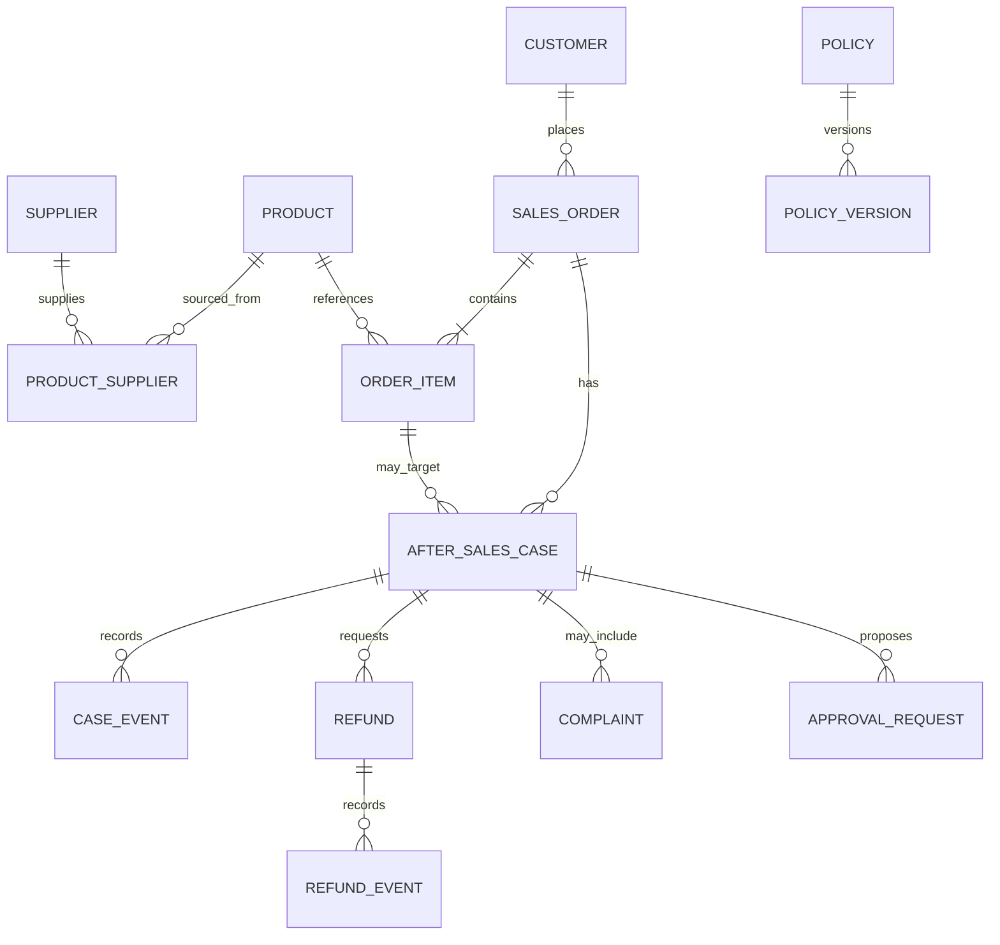

# AfterCare AI 数据库设计

> 状态：V0.1 概念草案，尚无数据库实现或迁移。本文用于 Day 1 讨论，不代表字段已经确认。除“设计原则”外，表、字段、状态和索引均为“待确定”候选。

## 1. 设计原则（已确定）

- 使用 MySQL 8，ORM 计划采用 SQLAlchemy 2，迁移计划采用 Alembic。
- 核心业务数据与 Agent 工作文件、运行检查点分开管理。
- 金额不使用浮点数；具体采用最小货币单位整数或 `DECIMAL` 待确定。
- 业务标识和数据库主键分离，避免把可变外部编号作为内部关联基础。
- 状态采用受约束的有限集合，并由服务层实施合法状态转换。
- 政策和敏感操作保留版本与审计信息。
- 种子数据必须可重复生成，不包含真实客户信息。

## 2. 候选实体关系



是否保留 `CUSTOMER`、`COMPLAINT`、`PRODUCT_SUPPLIER`、事件表和审批表在 Phase 1 全部落地，待 Day 1 根据用例最小化。

## 3. 核心实体字段草案

所有表默认候选审计字段为 `created_at`、`updated_at`；是否统一使用软删除、`created_by` 和乐观锁版本号待确定。

### 3.1 `sales_orders`（订单）

| 字段 | 用途 | 约束/待确定项 |
| --- | --- | --- |
| `id` | 内部主键 | BIGINT 或 UUID 待确定 |
| `order_no` | 对外订单号 | 唯一、不可为空 |
| `customer_id` | 客户关联 | 客户实体是否落库待确定 |
| `status` | 订单状态 | 状态集合与转换待确定 |
| `currency` | 币种 | ISO 4217，是否首版固定 CNY 待确定 |
| `total_amount` | 订单总额 | 金额存储方式待确定 |
| `paid_amount` | 实付金额 | 与支付记录关系待确定 |
| `placed_at` | 下单时间 | 时区规范待确定 |
| `paid_at` | 支付时间 | 可空 |
| `completed_at` | 完成时间 | 可空 |

候选索引：`UNIQUE(order_no)`、`INDEX(status, placed_at)`。查询模式确认后定稿。

### 3.2 `order_items`（订单项）

| 字段 | 用途 | 约束/待确定项 |
| --- | --- | --- |
| `id` | 内部主键 | 待确定 |
| `order_id` | 所属订单 | 外键，不可为空 |
| `product_id` | 商品关联 | 外键，不可为空 |
| `sku_code` | 下单时 SKU 快照 | 是否单独 SKU 实体待确定 |
| `product_name_snapshot` | 商品名快照 | 防止商品信息变化影响历史 |
| `quantity` | 购买数量 | 大于 0 |
| `unit_price` | 成交单价 | 金额规范待确定 |
| `paid_amount` | 订单项实付 | 分摊规则待确定 |

候选索引：`INDEX(order_id)`、`INDEX(product_id)`。

### 3.3 `after_sales_cases`（售后工单）

| 字段 | 用途 | 约束/待确定项 |
| --- | --- | --- |
| `id` | 内部主键 | 待确定 |
| `case_no` | 工单编号 | 唯一、不可为空 |
| `order_id` | 关联订单 | 外键，不可为空 |
| `order_item_id` | 关联订单项 | 是否允许整单售后待确定 |
| `case_type` | 退款/退货退款/投诉等 | 类型集合待确定 |
| `reason_code` | 标准原因 | 分类体系待确定 |
| `reason_text` | 用户补充描述 | 长度与脱敏规则待确定 |
| `status` | 工单状态 | 状态机待确定 |
| `requested_amount` | 申请金额 | 可退款上限规则待确定 |
| `opened_at` | 发起时间 | 不可为空 |
| `closed_at` | 关闭时间 | 可空 |

候选约束：同一订单项并发工单限制待确定。候选索引：`UNIQUE(case_no)`、`INDEX(order_id, status)`、`INDEX(status, opened_at)`。

### 3.4 `refunds`（退款）

| 字段 | 用途 | 约束/待确定项 |
| --- | --- | --- |
| `id` | 内部主键 | 待确定 |
| `refund_no` | 退款业务编号 | 唯一、不可为空 |
| `case_id` | 所属售后工单 | 外键，不可为空 |
| `status` | 退款状态 | 状态机待确定 |
| `amount` | 退款金额 | 大于 0，累计上限规则待确定 |
| `currency` | 币种 | 应与订单一致，例外待确定 |
| `channel` | 原路退回渠道 | 渠道集合待确定 |
| `idempotency_key` | 防止重复发起 | 生成与唯一范围待确定 |
| `failure_code` | 标准失败码 | 分类体系待确定 |
| `failure_message` | 渠道失败信息 | 脱敏与长度待确定 |
| `requested_at` | 发起时间 | 不可为空 |
| `completed_at` | 完成时间 | 可空 |

候选索引：`UNIQUE(refund_no)`、`INDEX(case_id, status)`、`INDEX(status, requested_at)`；`idempotency_key` 唯一策略待确定。

### 3.5 `products` 与 `suppliers`（商品和供应商）

| 实体 | 候选关键字段 | 待确定事项 |
| --- | --- | --- |
| `products` | `id`, `product_code`, `name`, `category_code`, `status` | SKU/类目建模、历史快照 |
| `suppliers` | `id`, `supplier_code`, `name`, `status` | 供应商敏感字段范围 |
| `product_suppliers` | `product_id`, `supplier_id`, `valid_from`, `valid_to`, `is_primary` | 是否需要历史供货关系、唯一约束 |

批量分析需要能够把投诉时点关联到当时供应商，不能默认用当前供应商覆盖历史；首版是否实现时态关系待确定。

### 3.6 `policies` 与 `policy_versions`（政策）

| 字段 | 用途 | 约束/待确定项 |
| --- | --- | --- |
| `policies.id` | 政策主键 | 待确定 |
| `policies.policy_code` | 稳定政策编码 | 唯一 |
| `policy_versions.version` | 版本号 | 与政策组合唯一 |
| `policy_versions.status` | 草稿/生效/废止 | 发布流程待确定 |
| `policy_versions.content` | 结构化或文本内容 | 格式待确定 |
| `policy_versions.effective_from/to` | 生效区间 | 区间重叠规则待确定 |
| `policy_versions.scope` | 店铺/类目/商品等范围 | 表达方式和优先级待确定 |

政策引用必须能定位到确定版本和条款。条款是否拆表、是否采用全文/向量检索待验证。

### 3.7 事件、投诉与审批（候选）

- `case_events`：记录工单状态变化、操作者、原因和发生时间。
- `refund_events`：记录渠道请求、回调、失败和重试，用于调查“为何未成功”。
- `complaints`：若投诉具有独立分类、严重度和处理流程，则从售后工单拆分。
- `approval_requests`：记录建议类型、目标对象、建议参数快照、状态、申请人与失效时间。
- `approval_decisions`：记录审批人、决定、理由、时间与版本，是否允许多级审批待确定。
- `audit_logs`：通用审计表还是按领域事件审计待确定，不应盲目复制所有敏感正文。

## 4. 状态机草案

以下仅为讨论起点，不能作为实现依据。

### 售后工单

```text
OPEN -> INVESTIGATING -> WAITING_CUSTOMER / WAITING_MERCHANT
     -> APPROVED / REJECTED -> CLOSED
```

需要确认：是否允许撤销、重开、部分批准，以及哪个角色可以触发每个转换。

### 退款

```text
REQUESTED -> PROCESSING -> SUCCEEDED
                       -> FAILED -> PROCESSING（是否允许重试待确定）
REQUESTED -> CANCELLED（条件待确定）
```

需要区分业务拒绝、渠道失败、超时未知和最终失败，避免把“未成功”全部归为同一状态。

### 审批

```text
PENDING -> APPROVED / REJECTED / EXPIRED / CANCELLED
```

批准后是直接执行、进入执行队列还是创建独立命令记录，待 Phase 3 决定。

## 5. 事务与一致性问题（待设计）

- 创建退款建议与审批请求是否要求同一事务；
- 退款执行如何使用幂等键、数据库唯一约束和渠道查询避免重复；
- 渠道回调乱序、重复和延迟时如何更新最终状态；
- 订单可退款金额如何计算及锁定，并发申请如何处理；
- Agent 检查点与业务事务不共享原子提交时如何恢复；
- 历史政策和商品/供应商关系如何按业务发生时点查询。

## 6. 数据与索引验证方法

Day 1 应先用核心查询反推模型：

1. 按 `order_no` 获取订单、订单项、工单和退款链路；
2. 按 `case_no` 查看状态历史与所有退款尝试；
3. 按时间范围统计投诉商品、原因和供应商；
4. 按业务发生时间找到有效政策版本；
5. 检查一个建议是否已审批、已执行或已失效。

索引只在查询形态明确后落地，并通过 `EXPLAIN` 和代表性数据量验证。初始化阶段不声明性能目标。

## 7. Day 1 预期产出

- 确认核心术语和业务规则；
- 确认 Phase 1 最小实体集合；
- 确认订单、工单、退款的状态与合法转换；
- 确认标识、金额、时间、审计和删除规范；
- 以三个核心场景走查关系和查询；
- 将确认结果更新到本文，并在 `DECISIONS.md` 记录关键选择。

